<p align="center">
  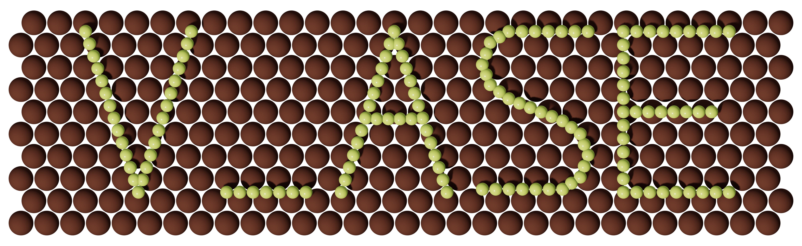
</p>

# v_ase

View, edit, analyze, and render atomic structures, trajectories, and volumetric
data in an ASE-native workspace. Use v_ase as a desktop app, in your browser,
or in Jupyter.

[](https://pypi.org/project/v-ase-gui/)
[](https://v-ase.readthedocs.io/en/latest/)
[](LICENSE)

## Download and install

**[Download for macOS or Windows](https://v-ase.readthedocs.io/en/latest/desktop.html#choose-a-download)**

Choose the installer or ZIP for your computer. The desktop app includes Python.

### Python and Jupyter

With Python 3.10 or newer, install [v_ase from PyPI](https://pypi.org/project/v-ase-gui/).

```bash
python -m pip install v_ase-gui
v_ase gui
```

Use `v_ase gui POSCAR` to open a file from the command line. In Python or Jupyter,
pass an ASE object directly to v_ase.

```python
from ase.build import molecule
from v_ase import view

view(molecule("H2O"))
```

[Python installation](https://v-ase.readthedocs.io/en/latest/installation.html) ·
[Jupyter and remote systems](https://v-ase.readthedocs.io/en/latest/notebooks-remote.html)

## Open, edit, and save

1. Choose **File → Open** or drop a structure file into the window. v_ase reads
   extended XYZ, ASE trajectories, CIF, VASP files, and [other formats](https://v-ase.readthedocs.io/en/latest/formats.html).
2. Use **View only** to inspect a structure or play a trajectory. Switch to
   **Edit structure** to change atoms, coordinates, or the cell.
3. Save a `.vase` project to continue editing later. Use
   **Export HTML View** to share an interactive view or **Render → Image** to
   save a figure.

Open several files in **Separate tabs** or combine them into **One trajectory**.
Use **Replace structure only** to load new frames into the current tab while
keeping its camera, appearance, and render settings.

The inspector groups tools under **Style**, **Build**, **Analyze**, and
**Render**. **Find tools…** (⌘F / Ctrl+F) searches across them.
Choose a workspace palette under **Style → Display & guides → Palette**.
Drag a tab below the tab bar to move it into its own window. Nearby v_ase
windows align at their edges when you drag a window by its title bar.

[Quick start](https://v-ase.readthedocs.io/en/latest/quickstart.html) ·
[Example files](https://v-ase.readthedocs.io/en/latest/example-inputs.html) ·
[Workspace controls](https://v-ase.readthedocs.io/en/latest/workspace.html) ·
[Keyboard shortcuts](https://v-ase.readthedocs.io/en/latest/shortcuts.html)

**Shape a structure directly in the viewport.** Select successive parts of a
phosphorene ribbon and rotate them into a twist. The camera stays in place
while you edit the coordinates.

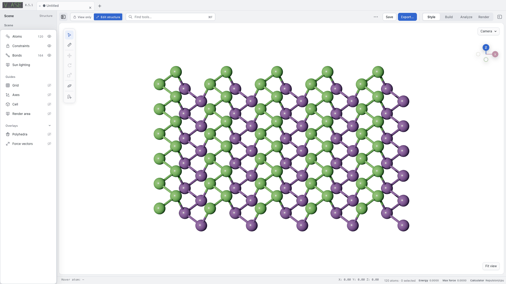

[Build and edit](#build-and-edit) · [Water and fields](#water-and-volumetric-fields) ·
[Periodic interfaces](#periodic-cells-and-interfaces) · [Appearance](#atoms-bonds-and-coordination) ·
[Trajectories and analysis](#trajectories-and-analysis) · [Constraints and relaxation](#constraints-and-relaxation) ·
[AI collaboration](#work-with-an-ai-agent) · [Rendering](#render-and-export) · [Save and share](#save-and-share)

## Build and edit

### Start from an empty cell

Create a cell, choose a composition and populate it with atoms. Build a crystal
with ASE, or prepare a disordered starting structure and remove close contacts.

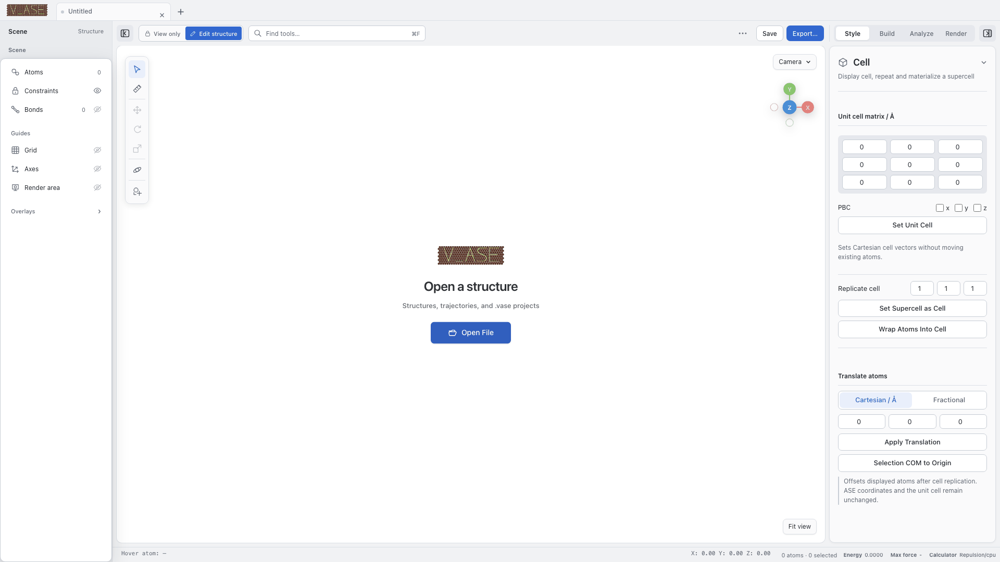

[Atomic distributions](https://v-ase.readthedocs.io/en/latest/atomic-distributions.html) ·
[Crystal and atom builders](https://v-ase.readthedocs.io/en/latest/build-atoms.html)

### Add atoms where you need them

Define an insertion region and control composition, density and allowed space.
Here, oxygen is added around an existing copper structure while the host remains in place.

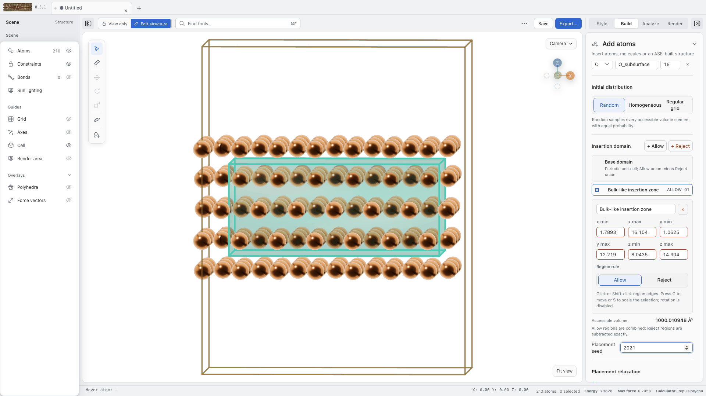

[Insertion regions and placement](https://v-ase.readthedocs.io/en/latest/insertion-regions.html)

### Fill pores and surround surfaces with molecules

Insert rigid molecules into a selected region, set their number or density,
and relax close contacts before keeping the result. This example places water
around hydroxylated graphene-oxide layers.

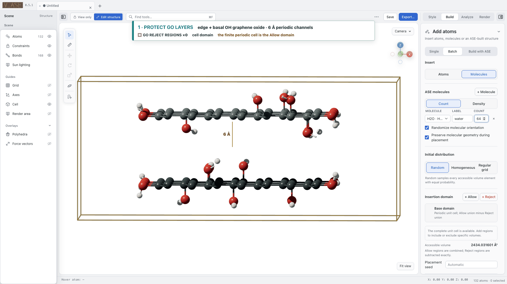

[Molecular insertion](https://v-ase.readthedocs.io/en/latest/molecules.html)

### Move, rotate and scale selected atoms

Use `G`, `R` and `S` for direct manipulation, or enter exact values. Rotate a
fragment about its center, the active atom, or a chosen pivot. Press Enter to
apply the preview or Escape to restore the starting positions. Use
**Build → Rigid translation** to move selected or all atoms by Cartesian Å or
fractional cell units in the current frame or every frame.

Right-click a viewport object for its actions. When you have selected atoms,
the menu also offers actions for that selection. Right-drag pans the view.

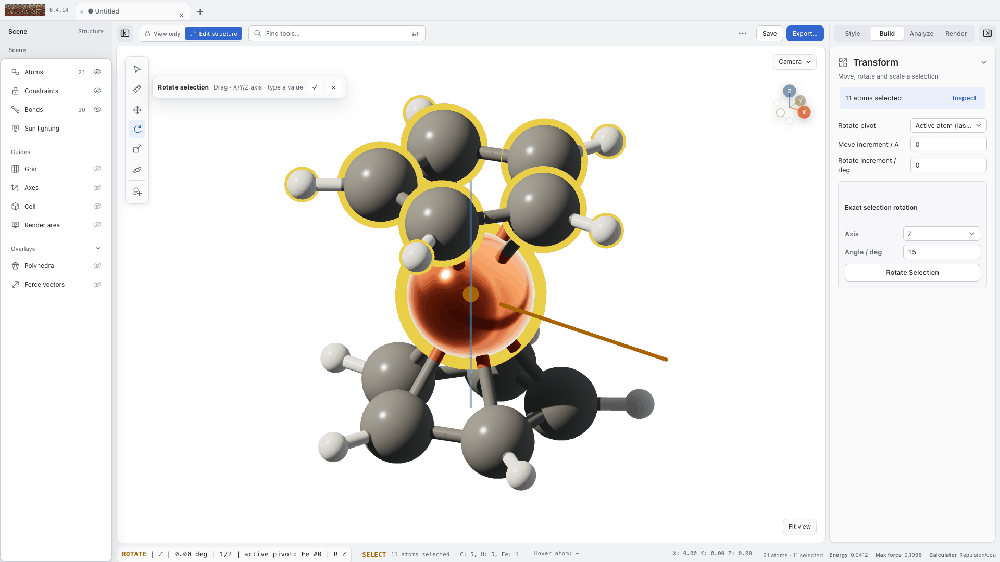

[Move](https://v-ase.readthedocs.io/en/latest/move.html) ·
[Rotate and choose a pivot](https://v-ase.readthedocs.io/en/latest/rotate.html) ·
[Scale](https://v-ase.readthedocs.io/en/latest/scale.html) ·
[Keyboard controls](https://v-ase.readthedocs.io/en/latest/shortcuts.html)

## Water and volumetric fields

### Show water as a continuous surface

Turn H₂O coordinates into a translucent water envelope while keeping ions and
solids visible. Adjust color, opacity, smoothing and lighting, and follow the
surface through a trajectory.

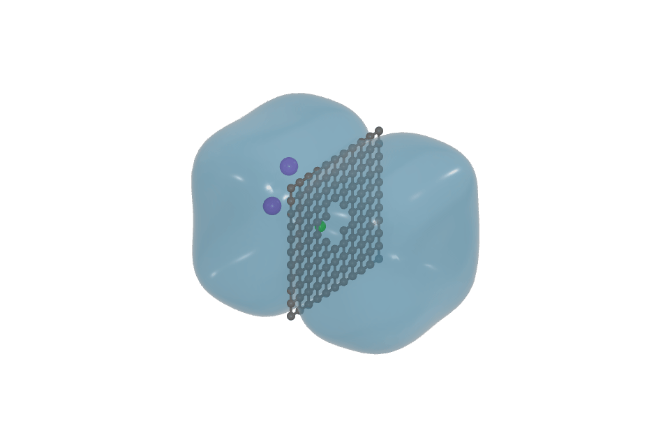

[Water surfaces](https://v-ase.readthedocs.io/en/latest/water-surface.html)

### Explore charge, potential and orbital fields

Display positive and negative isosurfaces, change the threshold, and control
color and transparency. The example below changes the isovalue of a fixed
signed field around a carbon structure.

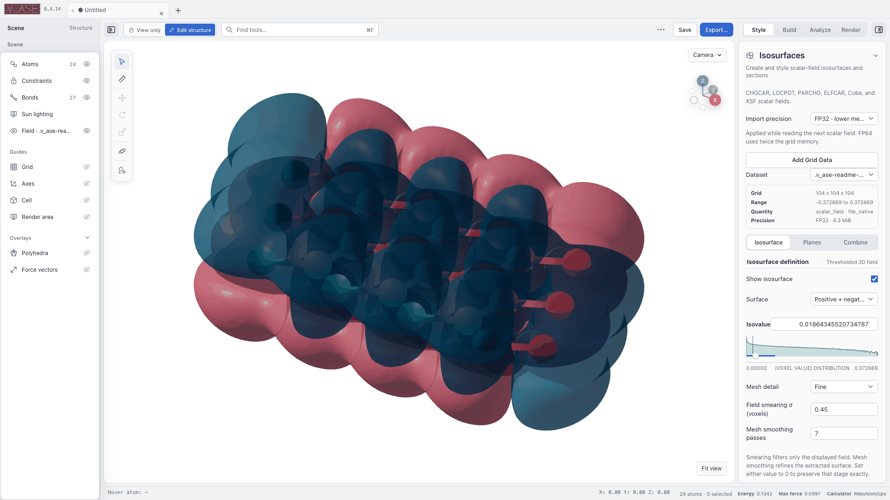

[Isosurfaces](https://v-ase.readthedocs.io/en/latest/isosurfaces.html) ·
[Import and combine fields](https://v-ase.readthedocs.io/en/latest/field-processing.html)

### Slice through a scalar field

Move a colored section through the data to inspect what lies inside. Choose
Cartesian or crystallographic planes and keep the atomic structure in view.

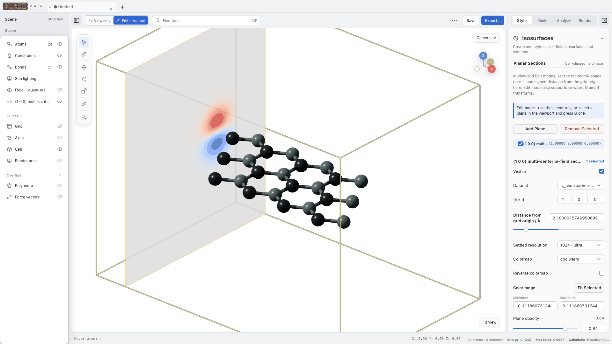

[Field planes and cross-sections](https://v-ase.readthedocs.io/en/latest/field-planes.html)

## Periodic cells and interfaces

### Find a common cell for rotated layers

Explore relative rotations and compatible periodic cells within your strain
and size limits. Preview candidates before creating the matched structure.
Cell tools also provide supercells, wrapping and cell transformations.
Press `A`, `B` or `C` for an upright view along that lattice vector. Press it
again for the opposite side. `X`, `Y` and `Z` select Cartesian views.

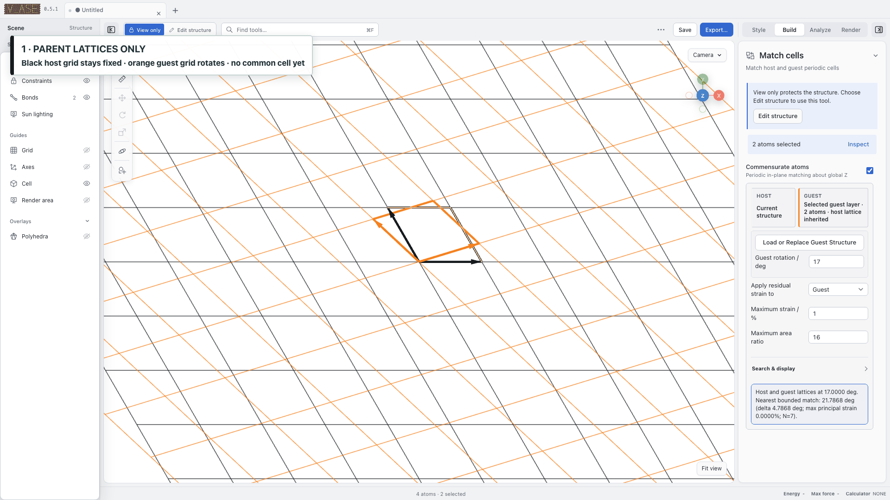

[Commensurate rotation](https://v-ase.readthedocs.io/en/latest/commensurate.html#commensurate-same-lattice-rotation) ·
[Cells and supercells](https://v-ase.readthedocs.io/en/latest/cell-tools.html)

### Match different host and guest lattices

Load a second material, search possible common cells and compare the required
strain. Here, graphene and MoS₂ are matched as separate host and guest structures.

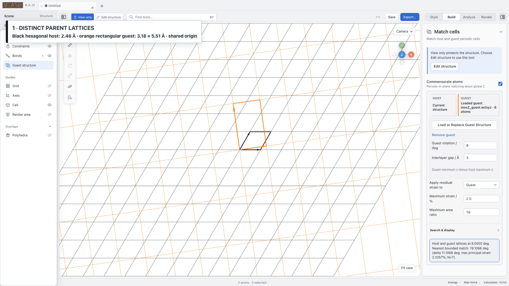

[Host/guest matching](https://v-ase.readthedocs.io/en/latest/commensurate.html)

### Explore interfacial registry

Scan lateral alignments or relax a whole selected fragment as one rigid body.
Registry maps compare geometric contact or bond-strain scores while preserving
the fragment's internal structure. Use **Finish** to keep the result or
**Cancel** to restore the starting structure.

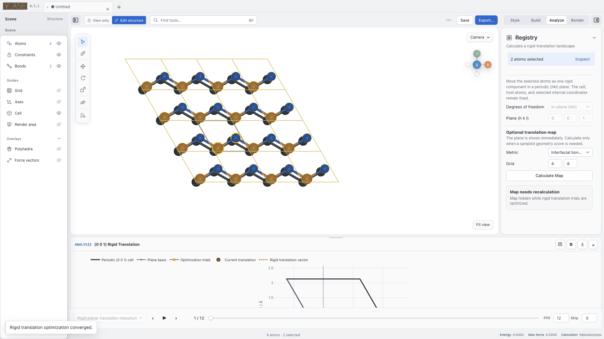

[Registry maps and rigid translation](https://v-ase.readthedocs.io/en/latest/registry.html)

## Atoms, bonds and coordination

### Give scientific groups their own appearance

Separate substrate, surface, and adsorbate atoms into labels. Set each group's
color, radius, opacity, and material. Choose which atom pairs form visible bonds.
The **Atoms** eye in Scene hides just the atom glyphs and leaves bonds,
constraint marks and the cell visible. Bond appearance updates live, including
enabled label-pair overrides. The Bonds inspector indicates when overrides
are active and offers **Use global appearance for all bonds**.
The **Bonds** eye controls the drawing. The count stays visible and follows the
current frame and bond definitions.

Use **Selected atoms → Apply to** to choose the current frame or all
compatible frames.
**⌘Shift+P / Ctrl+Shift+P** opens the label field for the selection.
In **Per-label appearance**, a new label name applies across the trajectory.
Renaming to an unused name updates the Distribution legend and retains its
curves and axis limits.

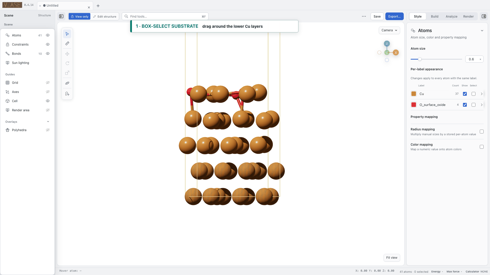

[Atom appearance](https://v-ase.readthedocs.io/en/latest/appearance.html) ·
[Pair-specific bonds](https://v-ase.readthedocs.io/en/latest/bonds.html)

### Reveal coordination polyhedra

Open a CIF directly or choose **CIF crystal structure** in the reader list.
Under **Style → Polyhedra**, turn on **Show polyhedra** to create editable
initial distance rules. The circled **!** explains the radii criterion.
Each rule lists its cutoff and observed coordination counts. Enable
**Use bonded neighbors only** to limit the ligands to bonded atoms.
For vermiculite this resolves both SiO₄ tetrahedra and MgO₆ octahedra.

Show local coordination as faces, edges and ligand connectors. Give different
center groups their own colors and transparency, in both 3D and flat 2D views.

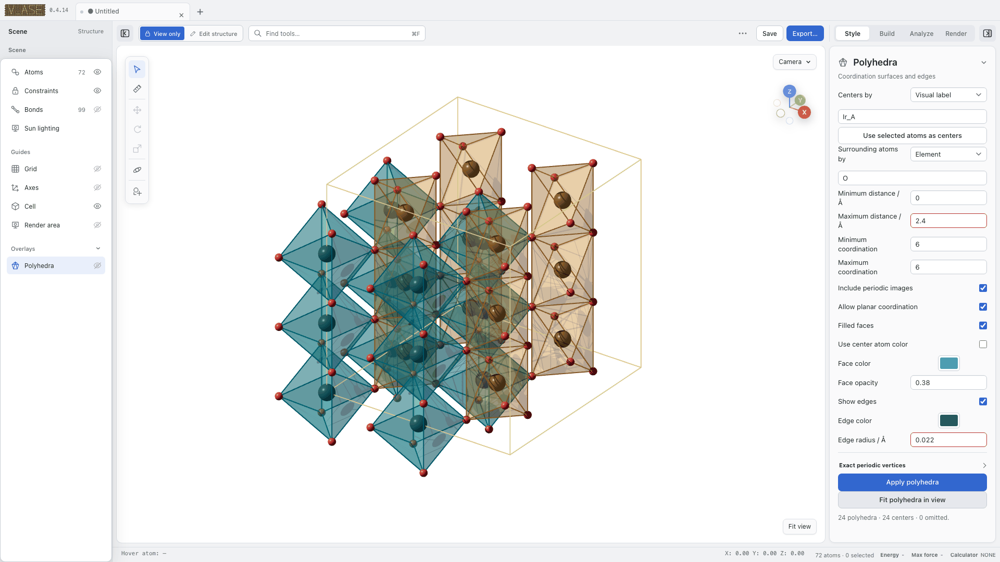

[Coordination polyhedra](https://v-ase.readthedocs.io/en/latest/polyhedra.html)

## Trajectories and analysis

### Follow motion and map per-atom properties

Scrub or play a trajectory, color atoms by stored scalar data, and display force
or displacement vectors. Keep a shared colorscale across frames for comparison.
Atom radii can also follow a scalar such as charge or fractional existence.

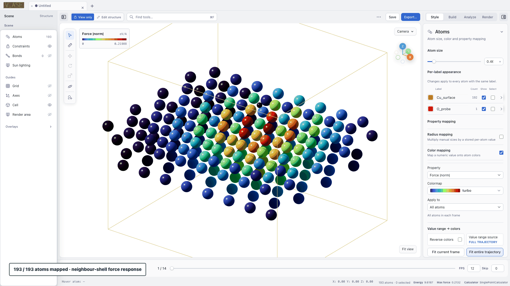

[Trajectories](https://v-ase.readthedocs.io/en/latest/trajectories.html) ·
[Colorscales](https://v-ase.readthedocs.io/en/latest/scalar-colors.html) ·
[Property-based radii](https://v-ase.readthedocs.io/en/latest/property-radius.html) ·
[Forces and displacement](https://v-ase.readthedocs.io/en/latest/vectors.html)

### Edit and match frames

Press **Home** or **End** to jump to the first or last frame. In **Edit
structure**, **⌘T / Ctrl+T** inserts a copy after the current frame. Add
**Shift** to put the copy at the end. Right-click the timeline to duplicate
or delete a frame. Undo restores a deleted frame and its saved data.

Use **Match** on the timeline to align each frame's atom order to the first
frame. Choose **Minimum image** (default), **Cartesian distance**, or
**SOAP + translation**.

[Trajectory tools](https://v-ase.readthedocs.io/en/latest/data-input.html#trajectory-tools) ·
[Frame and label editing](https://v-ase.readthedocs.io/en/latest/trajectories.html#frame-identity-and-selection)

### Follow energies and fit a NEB path

**Overlays → Energy graph** plots saved energies, follows playback, and seeks
to a frame when you drag the marker. Click the graph or its Scene row to
choose colors, line styles, markers, and axis limits. Export the graph as PNG
or its data as CSV.

In **NEB**, enable **Force-based fit** to fit a saved band with ASE. Enable
**Force tangents** to show and style the tangent at each image. **Minimum
image (PBC)** is on by default. Turn it off to fit the stored Cartesian
coordinates after matching indices.

[Energy graph and NEB fits](https://v-ase.readthedocs.io/en/latest/data-input.html#neb-fits-and-force-tangents)

### Measure distances, angles and torsions

Pick atoms in order to measure a distance, angle, or torsion. Drag to select
a group for editing.

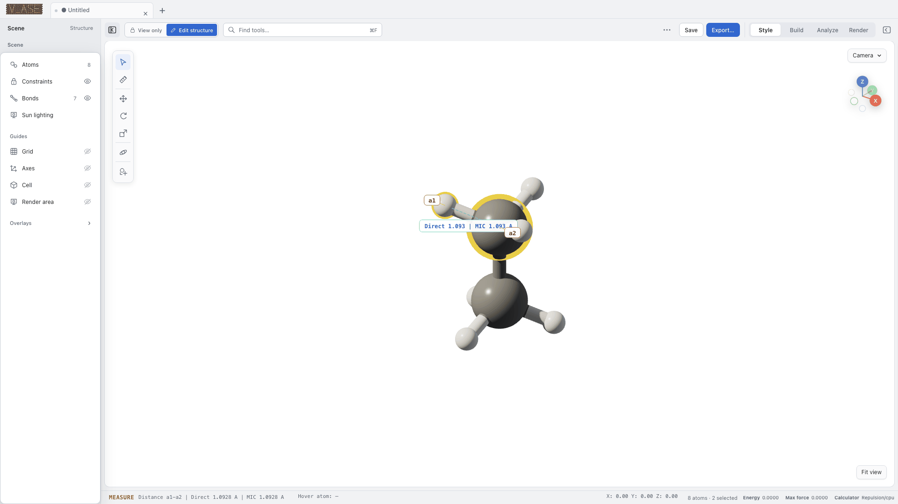

[Selection and measurements](https://v-ase.readthedocs.io/en/latest/selection.html)

### Compare local structure with pair distributions

Plot bulk *g(r)* for 3D periodic cells, the neighbor density by distance for
slabs and wires, or pair-distance probabilities for finite structures. **Use
periodic boundaries (PBC)** is on by default. Float distribution graphs,
registry maps or commensurate plots over the viewport and dock them below again.
Drag a floating plot by its title. Drag its lower-right grip to snap the right
or bottom edge to another floating graph. Click the graph to open **Graph
settings**. Select **Data series** to set a curve's legend name, line and
markers. Background, grid, fonts, tick labels and axis limits apply to the
whole graph. Valid limits update as you type, and an empty limit stays
automatic. Export the styled graph as PNG or the curves as CSV.

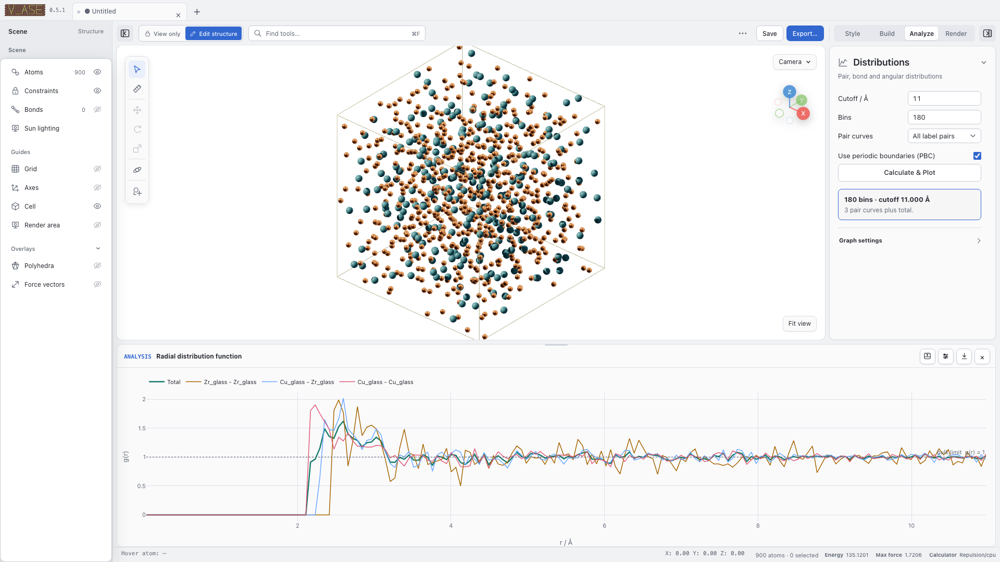

[Radial and pair distributions](https://v-ase.readthedocs.io/en/latest/rdf.html)

## Constraints and relaxation

### Control which directions atoms can move

Keep atoms fixed, restrict motion to a line or plane, or constrain selected
Cartesian or fractional directions. Visible guides make the allowed motion clear.

**FixedLine** restricts the selected atoms to the guide line.
The guide's length and thickness follow atom-size mappings immediately,
including animated trajectories and saved projects.

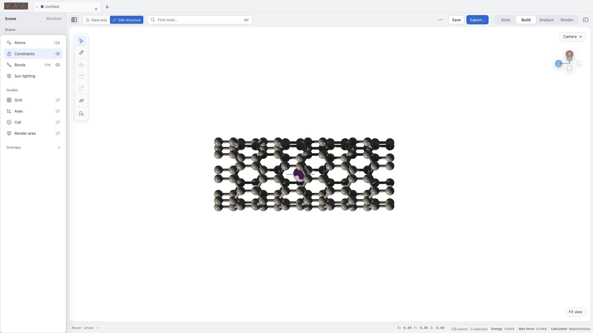

**FixedPlane** lets you move an adsorbate while holding its height above a surface.
A translucent pale cyan face fills each allowed plane, framed by narrow, darker inner and outer rims.
Selecting or hovering reveals the blocked normal with a dashed line and X ends.
Selection expands the ring around the yellow outline while preserving its face width.
The ring and atom occlude one another at their actual 3D depth.
Drag with the Orbit tool to inspect the plane from any angle. Shift-drag pans.

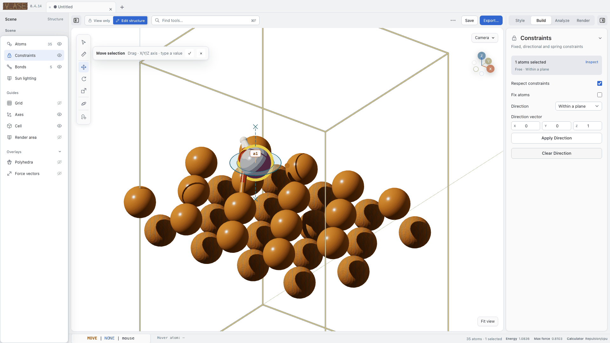

[Fixed atoms, lines, planes and fractional constraints](https://v-ase.readthedocs.io/en/latest/constraints.html)

### Add spring-like restraints

Use Hookean restraints between atoms or relative to a point or plane. The
spring guide shows the relationship as the structure changes.

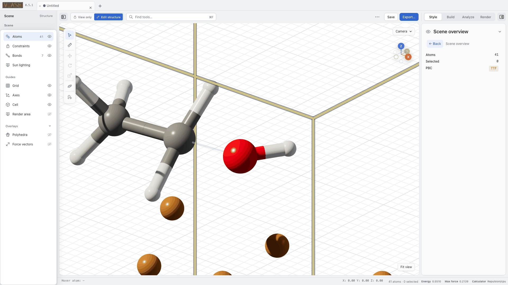

[Hookean restraints](https://v-ase.readthedocs.io/en/latest/constraints.html#hookean)

### Relax and inspect the path

Remove close contacts with built-in repulsion, or optimize using a configured
ASE calculator. Play the relaxation trajectory, keep a chosen frame, or restore
the starting structure. The example shows repulsive overlap removal.

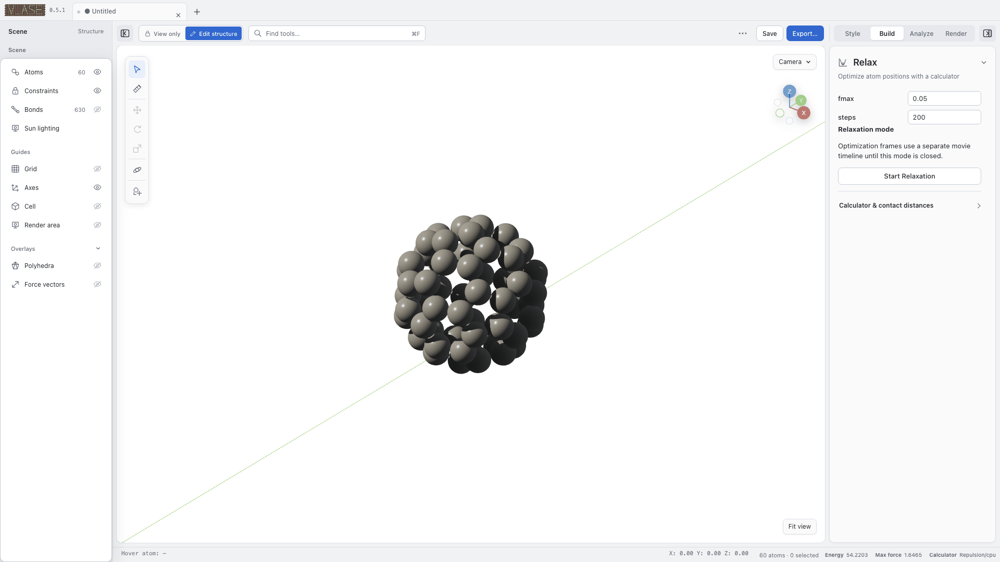

[Relaxation and calculators](https://v-ase.readthedocs.io/en/latest/relaxation.html)

## Work with an AI agent

Ask an MCP-capable agent to prepare a structure or figure in the same document
you have open. Watch its edits, inspect the result, and continue refining it by hand.
For v_ase 0.5.1, install the matching Skill for Claude Code, Codex, or Cursor.

```bash
npx skills@latest add lgyEthan/v_ase@v0.5.1 \
  --skill visualizing-atomic-structures-with-v-ase \
  -a claude-code codex cursor -g -y
```

Choose the clients you use. Omit `-g` for a project installation. Connect the
MCP server to give the agent access to the live document. For another runtime
version, use its matching tag.
[Skill and MCP setup](https://v-ase.readthedocs.io/en/latest/agent-setup.html)

You can also ask an agent to set up v_ase by reading
[`llms.txt`](https://raw.githubusercontent.com/lgyEthan/v_ase/main/llms.txt).

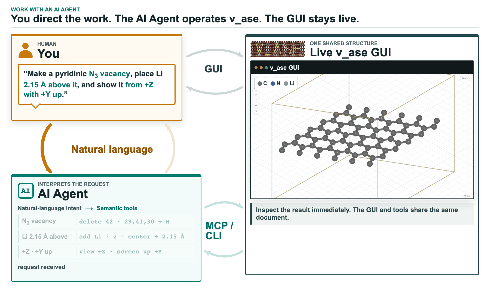

For example, turn a selected graphene site into a pyridinic N₃ vacancy and place
a Li atom above it. The resulting atoms remain editable in the GUI.

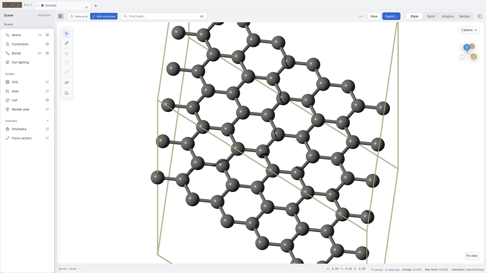

[MCP setup](https://v-ase.readthedocs.io/en/latest/ai-tools.html#install-and-connect-an-mcp-client) ·
[Shared-document workflow](https://v-ase.readthedocs.io/en/latest/ai-agents.html#share-one-document) ·
[ChatGPT connection](https://v-ase.readthedocs.io/en/latest/chatgpt-local.html)

## Render and export

Compose editable figures from generated structures. The six examples below
show three AuO₂ structures from CrystaLLM and three Li₄Fe₅CoO₁₂ structures from
ALM Edit. Download the examples to inspect the structure files and how each
figure was styled. [Model-output workflow](docs/model-output-figures.md) ·
[Portable example](examples/model_output_figures/README.md)

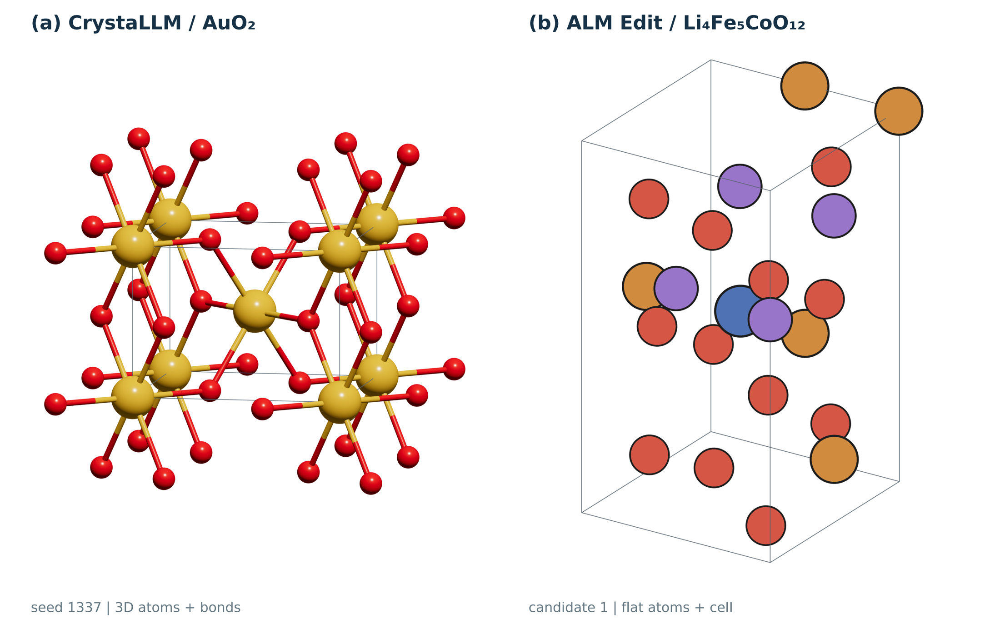

Choose flat 2D or shaded 3D, tune materials and lighting, and compose a render
area independently of your editing view. Set the resolution, background, and
physical scale in **Render → Image**, or export a selected trajectory range
as a movie or GIF. On a selected render area, press **S** and then **X**, **Y**,
or **Z** to resize along a projected axis. **Fix ratio** keeps it proportional.
In **2D flat**, **Outline width** sets a shared stroke width for the atoms and
bond ribbons. **Atom & bond segments** sets their rendering detail.

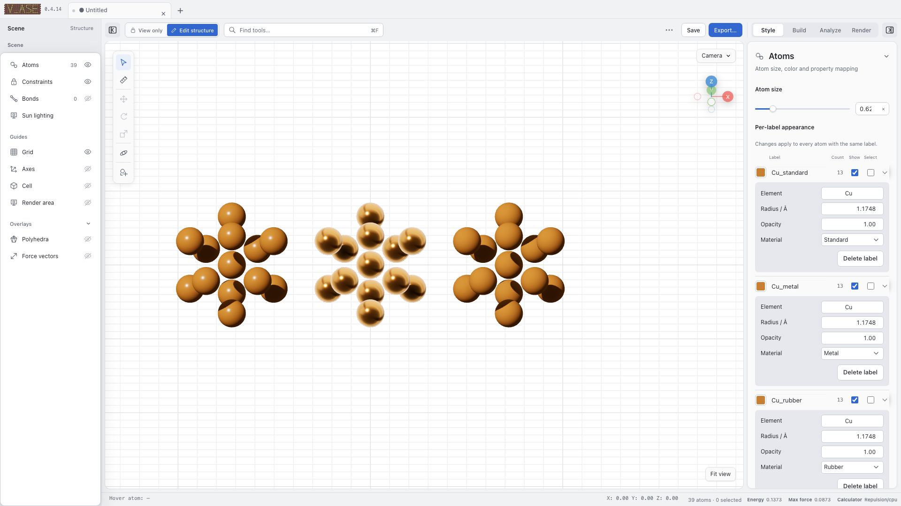

Continue working in **Blender** with editable atoms, bonds and water-surface
meshes, including trajectory animation. Blender opens with the exported camera,
Sun and surface materials. Atom spheres use Shade Smooth in both export modes.
Use **OBJ/MTL** or **Rhino 3DM** for additional geometry formats. Export
ASE structure formats to reuse the coordinates and scientific data.

[Camera and image output](https://v-ase.readthedocs.io/en/latest/render-images.html) ·
[Movies and GIFs](https://v-ase.readthedocs.io/en/latest/export-video.html) ·
[Blender and geometry export](https://v-ase.readthedocs.io/en/latest/export-structures.html)

## Save and share

| You want to… | Use |
| --- | --- |
| Continue editing later | **Save** a `.vase` project. |
| Share an interactive view that opens in a browser | [Export HTML View](https://v-ase.readthedocs.io/en/latest/save-projects.html#html-view). |
| Share a browser view that can also reopen for editing | In **Project save settings**, enable **Include interactive rendered view** and save as HTML. |
| Publish a figure or animation | Export an image, movie or GIF from **Render**. |

Use **Include graph** to add the Energy graph and floating Distributions to
the HTML preview, poster, and browser view. In the offline viewer,
Distributions follow the trajectory. **Reset saved view** restores the camera,
plot bounds, and legend visibility.

Reopen an editable HTML project in v_ase to recover its saved views and plots.
The editing view stays in place during export. v_ase compresses the embedded
viewer and graph data when it makes the file smaller. Resave an older HTML
project to refresh its Finder thumbnail on macOS.
[Saving projects](https://v-ase.readthedocs.io/en/latest/save-projects.html)

## Help and project information

[User guide](https://v-ase.readthedocs.io/en/latest/) ·
[Troubleshooting](https://v-ase.readthedocs.io/en/latest/troubleshooting.html) ·
[Report a problem](https://github.com/lgyEthan/v_ase/issues) ·
[What's new](https://v-ase.readthedocs.io/en/latest/whats-new.html)

[Scientific methods](https://v-ase.readthedocs.io/en/latest/scientific-validation.html) ·
[Contributing](https://v-ase.readthedocs.io/en/latest/development.html) ·
[Cite v_ase](CITATION.cff) · [AGPL-3.0-or-later](LICENSE) ·
[Third-party license](v_ase/static/vendor/THREE_LICENSE)
