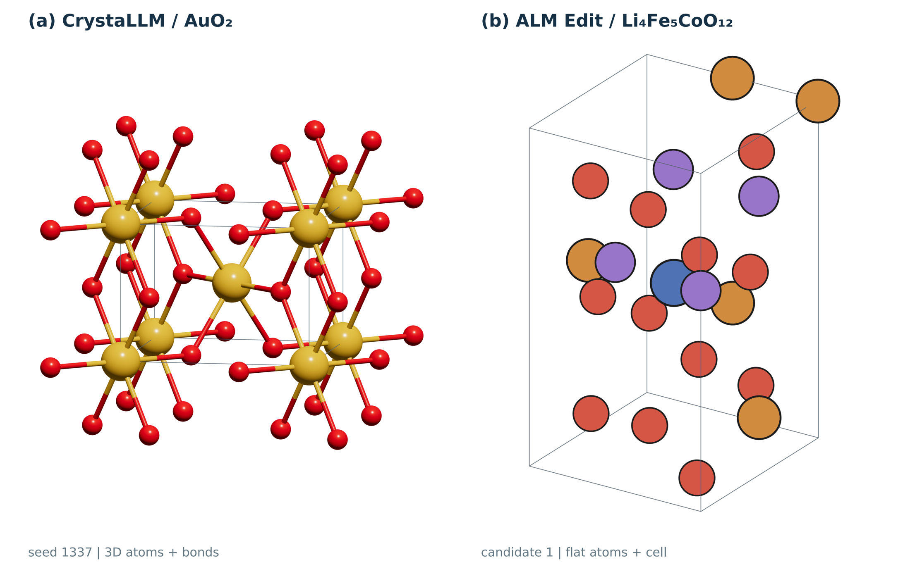

# From model outputs to editable figures

v_ase accepts generated atomic structures through the same ASE readers used for
simulation files. A useful publication workflow retains the model's scientific
output, defines a separate presentation scene, and saves that scene as an
editable `.vase` project alongside the final image.



These examples use three preserved CrystaLLM AuO2 samples and three ALM Edit
Li4Fe5CoO12 samples. They cover two material systems. CrystaLLM generates CIF
text; ALM Edit conditions an atomistic diffusion decoder on a structure and a
text instruction. The models produce structures outside v_ase. An external
agent or script then uses v_ase's native tools to compose and render the figures.

## Keep scientific data and presentation traceable

1. Keep the raw model output, processed structure, prompt, seed or candidate
   number, checkpoint revision and generation environment. Hash the input files.
2. Check composition, finite coordinates, positive cell volume and short
   periodic contacts. Apply the task's additional selection checks. These
   checks establish suitability for the example; they do not establish
   thermodynamic stability.
3. Make any display copy explicitly. Record equivalent cell-basis and origin
   transformations, atom-index mapping and periodic image offsets. Verify cell
   volume and periodic distances against the preserved source.
   Validate the file after serialization, not just the in-memory array.
   The portable example uses a lossless ASE trajectory and also reads the
   structure inside each exported project.
4. Open the display scene in View mode. Set projection, orientation, colors,
   rendered sphere radii and the desired cell and bond visibility. Visual bond
   cutoffs define drawn connections, independently of an energy calculator.
5. Render with explicit dimensions and physical px/Å scale. Inspect the image
   for clipping, colors, connections and correspondence with the reference.
6. Commit the matching output profile before saving the project. Reopen it and
   render again with omitted options to verify the stored composition and
   appearance. Preserve raw structures separately from presentation copies.

## Match the reference's drawing convention

For the AuO2 example, nine periodic Au centers and their oxygen neighbors are
shown with 3D spheres and split-color Au-O cylinders, using a 2.5 Å visual
cutoff. The source cell has six atoms; the finite presentation scene has 49
sites. Its extra sites are documented periodic images, not a generated
49-atom unit cell.

For Li4Fe5CoO12, the full 22-atom cell is drawn using flat atoms and a cell
outline. There are no bonds or additional periodic ligands. The corresponding
minimal native edit is:

```python
tools.call("vase_style_scene", {
    "expected_document_id": document_id,
    "expected_revision": revision,
    "atom_display_mode": "2d",
    "show_bonds": False,
    "show_cell": True,
})
```

Use the returned scene `revision`, or `collaboration.revision` from a legacy
describe response, for the next mutation. Confirm `display.showBonds == false`
and `display.renderedBaseEdgeCount == 0` in a bounded scene snapshot before
rendering and after reopening. Calling `configure-bonds` is unnecessary when
the request is only to hide bonds.

## Save the image profile, then verify reopening

A one-off `vase_render(width=..., height=..., options=...)` does not commit all
of those options to the project. In the GUI, commit the output dimensions,
physical scale, fixed camera, lighting and quality on **Render → Renderer**,
then save the project. For automated preparation, export the visual settings,
update their `settings.imageExportProfile`, and apply them through
`vase_load_settings` before `vase_export_project`.

The stored profile uses raw camelCase fields. To retain a fixed Studio render,
set `options.renderModeSelection` to `studio`; `current` follows the viewport's
lighting mode even if an earlier one-off render used Studio. Keep the actual
camera from the render result. This changes presentation only. Verify the
structure fingerprint before and after applying settings.

Reopen the `.vase` file and call `vase_render({})`. Check dimensions, appearance,
cell and bond visibility, scientific fingerprint and pixel output. Exact pixel
agreement was tested within the same browser/renderer environment; it is not a
guarantee across different GPU drivers or browsers. A reversible style change
and Undo also verify that the saved scene remains editable.

## Evidence and attribution

The 2026-10-26 review uses the published **v_ase 0.4.13 wheel** in a clean
environment with no inherited site-packages. The application was checked
against release commit `417b27fc76452a70692af3cdcf072dc50b197159` and the connected
GUI assets were compared with the imported package. Six scenes were regenerated
from preserved September model outputs. New model inference was not performed.

The portable example in `examples/model_output_figures/` supplies
the pinned inputs, manifest and executable preparation/rendering steps. It uses
integer source-to-display maps, checks the actual saved coordinates and refuses
incomplete or altered render receipts. Output records identify their runtime
version, date, recipe hash and actual camera/options. A prior report is not
evidence that a new version or changed recipe has been verified.

The reference presentation is CrystaLLM Figure 3d and ALM Figure 26. These are
new model samples, so captions should say **paper-style visualization of new
model outputs**. The ALM thumbnail's printed O2 formula differs from the
released input/generated O12 structures. Preserve the released 22-atom
structure rather than changing it to match the printed formula.

- Antunes, Butler and Grau-Crespo, *Crystal structure generation with
  autoregressive large language modeling*, Nature Communications 15, 10570
  (2024), [DOI](https://doi.org/10.1038/s41467-024-54639-7).
- Edamadaka, Ramesh, Li and Gómez-Bombarelli, *Atomistic Language Models
  Understand and Generate Materials*, arXiv:2606.21395v1 (2026),
  [paper](https://arxiv.org/abs/2606.21395).

The public image above contains our v_ase renders. The original CrystaLLM panel
is CC BY 4.0 with attribution. The ALM paper uses arXiv's non-exclusive
distribution license; that license does not itself grant third-party figure
republication rights. Its original thumbnail is retained in the comparison
review PDF; reuse of that thumbnail in a public article needs a separate rights
basis. The manuscript-ready figure contains only our renders.
