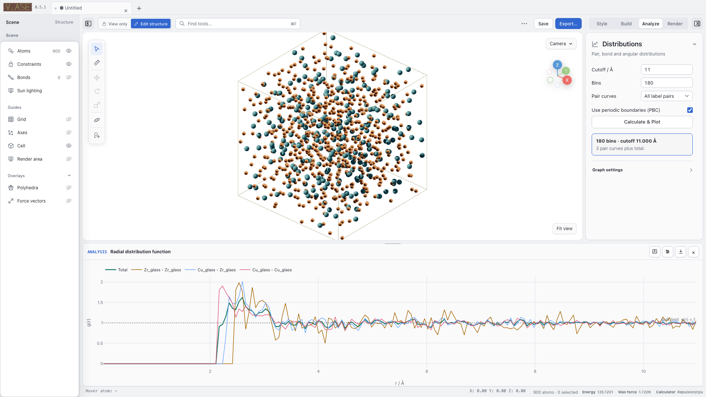

# Radial and pair distributions

Use pair statistics to inspect local spacing, coordination shells, and chemical
ordering. Open **Analyze > Distributions** after loading a structure
or selecting a trajectory frame.

```{contents} On this page
:local:
:depth: 1
```

## Choose the correct quantity

| Boundary conditions | Reported quantity | Meaning |
| --- | --- | --- |
| Periodic in all three axes | Bulk `g(r)`, dimensionless | Pair density divided by uniform bulk density |
| No periodic axes | Finite pair probability density, Å⁻¹ | Probability of an unordered pair distance in each radial interval |
| One or two periodic axes | Periodic pair distribution, neighbors per atom per Å | Radial neighbor density including images along the periodic axes |

Vacuum in a fully periodic slab still contributes to the cell volume. Enabling
all PBC flags for a slab makes its bulk `g(r)` normalization depend on that
vacuum. **Use periodic boundaries (PBC)** is on by default and honors the
structure's periodic axes. Clear it to analyze the stored Cartesian distances
as a finite structure.

## Calculate and interpret a plot

1. Select the intended frame. The plot uses the full physical structure, even
   when only some atoms are selected or a display supercell is visible.
2. Set a positive **Cutoff / Å** and an integer number of **Bins** from 8 to 5000.
3. Choose **Total only**, **All label pairs**, or the active/selected bond-pair filter.
4. Click **Calculate & Plot** to use the last placement. A new plot opens in
   the results drawer. Verify the title, units, cutoff, and frame.
5. Export CSV to save the actual plotted total and partial curves.

Use **Move graph to viewport** in the results drawer and **Dock graph below the
viewport** in the floating header. Registry maps and commensurate plots use the
same controls. Drag the title to move the graph. Drag the lower-right grip to
resize it and snap the dragged right or bottom edge to another floating graph,
including across a gap. The title and grip also accept arrow keys.
Click a Distribution or Energy graph to open **Graph settings** in the right
sidebar. **Data series** selects the curve whose legend name, line and markers
you are editing. Background, grid, legend visibility, font family and size, and
tick-label visibility and number format apply to the whole graph. The four
**Axis limits** apply as you type. A blank bound uses Auto. Configured limits
also apply after recalculation. Commensurate plots remember separate limits
for their 3D and 2D views.

Renaming a label to a new name updates the affected curve names and keeps the
calculated distances, series styles, and graph placement. A saved style preset
can be applied to another graph of the same type.

A floating distribution appears in image renders and in the HTML preview,
poster, and offline viewer when **Include graph** is selected. The offline plot
contains the distribution from the frame analyzed at export and supports zoom
and legend toggles.

The histogram includes distances on its final edge within floating-point
tolerance. For periodic data, the search includes every image inside the
requested sphere, including nonzero images of the same basis atom. A large
cutoff is allowed and does not depend on displayed replication, but it samples
repeated copies of this finite configuration rather than independent data.

The automatic periodic cutoff is half the smallest height in the periodic
lattice. For a finite structure it uses the diagonal of the atomic bounding box.
Increasing the bin count sharpens radial resolution
while increasing noise. This is an instantaneous frame statistic; obtain an
ensemble or time average separately if that is the desired observable.



## Example: reproduce the Cu–Zr plot

Download {download}`cuzr-rdf.traj <assets/examples/cuzr-rdf.traj>` and open it:

```bash
v_ase gui cuzr-rdf.traj
```

1. Open **Analyze > Distributions**.
2. Set cutoff **11 Å**, bins **180**, and **All label pairs**.
3. Click **Calculate & Plot**. Compare total, Cu–Cu, Cu–Zr and Zr–Zr curves.
4. Check the label counts and volume before interpreting the normalization.
5. Export CSV and verify its radius and partial-curve columns.

This is the exact 900-atom, 28 Å cubic, seed-20260731 hard-core fixture used in
 the image above. It illustrates disordered pair statistics; it is not an
 equilibrated metallic glass or a fitted experimental RDF.

## Normalization and partial curves

For a periodic cell of volume `V` with `N` atoms, bin edges `a,b`, and directed
neighbor count `H`, the total uses the exact shell volume:

```text
shell = 4π/3 × (b³ − a³)
g(r) = H / [(N²/V) × shell]
g(r) = Σα cα² gαα(r) + 2 Σα<β cα cβ gαβ(r)
```

`cα = Nα/N`. Same-label partials use `Nα²/V`, and mixed partials combine both
directions and use `2NαNβ/V`. Thus concentration weighting reconstructs the
total. Selected/active modes choose which label-pair curves appear; they do not
restrict the population used for normalization.

For an independent finite-N periodic random configuration below the unique-image
cutoff, the expected total is `(N−1)/N`, approaching one for large N. The dotted
one-line is a bulk reference, not a promise that every finite curve reaches one.

For a finite structure, each unordered pair is counted once and divided by
`N(N−1)/2` and bin width. The integral is one only when the cutoff includes all
pairs. Same-label partials use `Nα(Nα−1)/2`; a singleton label has a zero curve.

For a slab or wire, divide directed image-neighbor counts by `N` and bin width.
The integral is the mean neighbor count within the cutoff. The partial curves
sum to the total when all pairs are included. Distances use all three Cartesian
coordinates and images repeat along the specified periodic axes.

## Compute and export in Python

This example creates an ideal random periodic reference and writes an RDF CSV.
The returned `radius`, `total`, and `partial` arrays contain the plotted data.

```python
from pathlib import Path
import numpy as np
from ase import Atoms
from v_ase.analysis import calculate_rdf, rdf_csv

rng = np.random.default_rng(7)
atoms = Atoms("Ar1000", scaled_positions=rng.random((1000, 3)), cell=[25]*3, pbc=True)
result = calculate_rdf(atoms, cutoff=8.0, bins=100, pair_mode="all")
Path("argon-rdf.csv").write_bytes(rdf_csv(result))
print(result.title, result.y_label, result.cutoff)
```

For a finite pair distribution on any input, call `calculate_rdf` with
`use_pbc=False`. The CSV header identifies the reported quantity.

## Common interpretation mistakes

A visual bond cutoff is not an RDF distance cutoff. Displayed replicas do not
add independent samples. A smooth homogeneous placement is correlated and
should not be used as an ideal-gas normalization reference. A low repulsive
energy does not establish chemical order or physical stability.

See [trajectories](trajectories.md) for frame synchronization and
[scientific validation](scientific-validation.md) for the enumeration and
normalization regressions.

The horizontal axis shows distance in Å and the vertical axis names the current
quantity. Axis titles remain visible in short windows and both interface
appearances.
