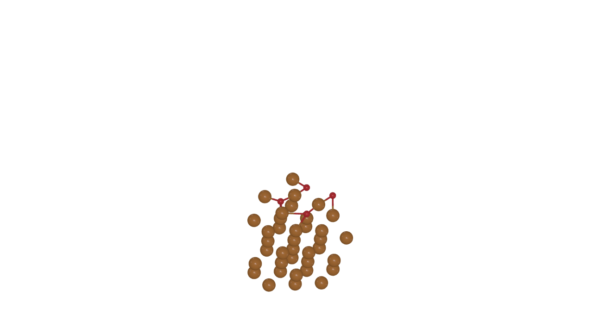

# Save and share

Use a project to continue editing, or export a viewing copy to share a result.

| You want to… | Choose |
| --- | --- |
| Resume the complete workspace later | **Save** as `.vase`. |
| Share an offline interactive view | **Render → Interactive HTML → HTML View**. |
| Share a browser view that can also reopen for editing | **Project save settings → Include interactive rendered view**, then save as HTML. |
| Save a figure or animation | [Image export](render-images.md) or [video/GIF export](export-video.md). |
| Use the structure in another scientific program | [Structure export](export-structures.md). |

## Save Project

Choose **File → Save**, or press **Command+S** on Mac / **Ctrl+S** on Windows
and Linux. The first save asks for a destination. Later saves reuse that file
and its format where write access is available.

### Compact `.vase`

A `.vase` project keeps your structures and trajectory, labels, constraints,
stored atom properties, fields, camera, appearance and render settings.
It is self-contained: the original input file is not needed to reopen it.
Use this format for your working copy.

### Project HTML

Open **File → Project save settings** and enable **Include interactive rendered
view**. Saving now creates an `.html` project with both an offline 3D viewer and
the editable project data.

The recipient can open it in a browser without Python. To continue editing,
open the same file with **File → Open** in v_ase. Project HTML is larger than
`.vase` because it also includes the viewer and preview image.
The editing view keeps its zoom and framing during Save. The embedded poster
uses the saved output camera and framing.

## HTML View

**Include graph** under **Scene overlays** controls the Energy graph and any
floating Distribution for both HTML View and Project HTML. Before exporting a
Distribution, click **Move graph to viewport** in its toolbar. The preview and
embedded poster show the graph placement and style from the interactive output.
A graph inside the visible Render Area keeps its location relative to that crop.
Graphs extending outside the frame are fitted inside it. Opening the dialog
pauses playback so the preview uses the same frame as the saved composition.
Click or drag on the offline Energy graph to seek source frames. The offline
Plotly Distribution shows the curve for each displayed frame. Plot zoom, pan
and legend choices persist while you seek or play the trajectory. **Reset saved
view** restores the camera, plot bounds and legend for the frame you are on.
Opening editable HTML in v_ase restores the saved floating Distribution and
its appearance. Save, Save As and HTML export use lossless gzip where it
reduces the embedded viewer or curve data. The HTML includes an offline fallback
decoder and retains the full-resolution PNG for Finder and Quick Look.
Save an older editable HTML project again to update its Finder thumbnail.

Choose **Render → Interactive HTML → HTML View** for an offline viewing copy with orbit, pan,
zoom and trajectory playback. The default does not include editable project data.
Enable project embedding if the recipient also needs to reopen it for editing.

An HTML View without that data cannot restore a full editing session.
Keep a `.vase` project of your own when exporting a viewing copy.

## Save As and existing files

**File → Save As** (`Command/Ctrl+Shift+S`) creates a separate file and makes it
the current save destination. A project opened as HTML continues saving as HTML;
a `.vase` project continues saving as `.vase`. Exporting an image or movie does
not change that destination.

Some browsers cannot write back to the original file and download a new copy
instead. v_ase labels a download as a copy and reports the saved HTML size.
In the desktop app, **Save** writes to the file opened through the system
picker. If the original file has changed outside v_ase, choose **Save As** to
keep your current work separately before deciding which copy to use.

## Reopening the saved workspace

Open a `.vase` or project HTML file to restore its saved frame, camera,
appearance and View/Edit mode. A project opens in a new tab when the current
document contains work. Older projects restore the settings available in them.

Different window sizes may change the panel layout while keeping the saved
structure and physical view scale. Appending a project to a trajectory imports
its structure frames rather than replacing the receiving document's appearance.

## Visual settings preset

Use **Export/Import Preset** to reuse a visual style on a different structure.
Presets contain presentation settings, not atoms, trajectory frames or fields.
A personal visual default applies compatible settings to new documents.
Use a project when you need to preserve the whole scene.

## Save lifecycle and progress

Tabs indicate unsaved changes. Closing or replacing a changed document offers
**Save**, **Discard** and **Cancel**. Canceling the save picker leaves your work
open. Wait for saving to finish before closing the app.

If saving reports an invalid input, correct that value and save again. If it
reports that a file changed externally, use **Save As** to preserve your work.

## Render area and visible objects

Image and animation exports use the render area and the objects you choose to
show. Set composition under **Render → Renderer → Render area & scale** and
visibility under **Objects**. Hiding constraint marks changes their appearance,
not the physical constraints. [Camera and image output](render-images.md#render-area).

## Example: send an interactive surface figure

1. Style a structure and save a `.vase` working project.
2. Export **HTML View** for a viewing-only handoff, or save **Project HTML**
   if the recipient also needs the editable project.
3. Open the exported HTML in a browser to review it before sharing.

The embedded poster shows the exported composition as the interactive viewer
loads. Finder and Quick Look can use the same image for previews on macOS.
